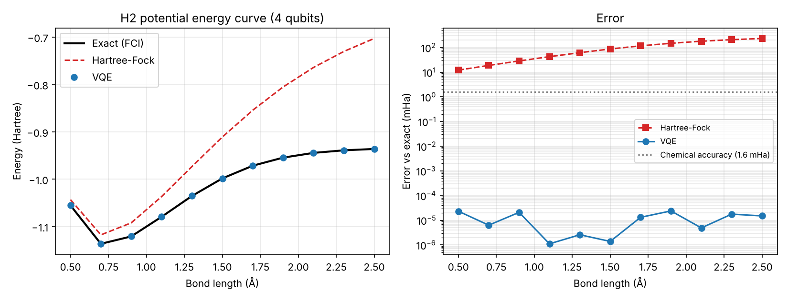
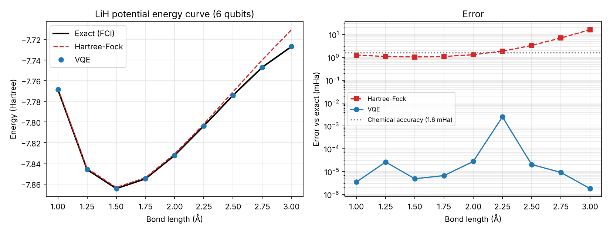
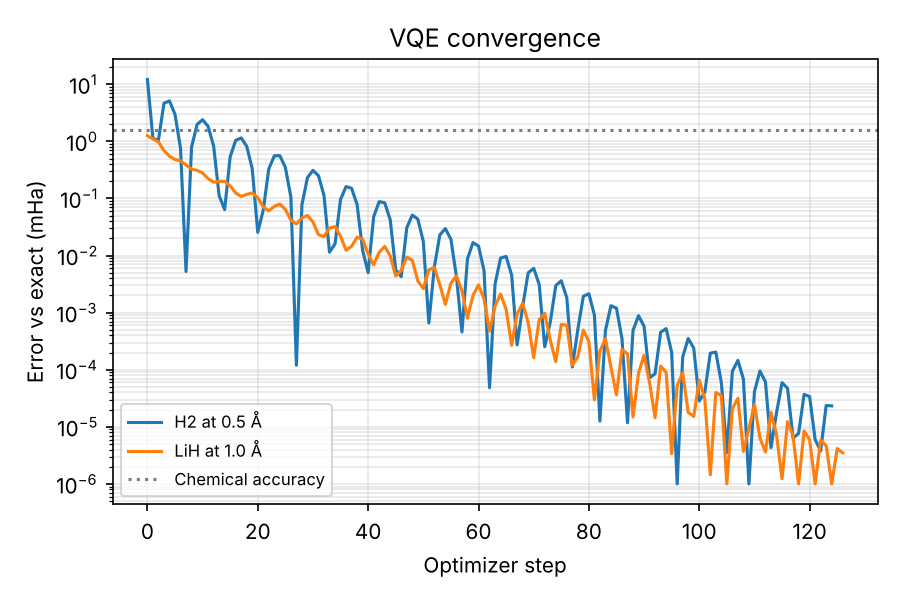

# VQE for molecular ground-state energies

Small project where I use the Variational Quantum Eigensolver (VQE) to compute the
potential energy curves of H2 and LiH, and compare it against Hartree-Fock and exact
diagonalisation. Everything runs on a simulator (PennyLane `default.qubit`).

## Why I did this

A lot of drug design comes down to knowing molecular energies well: how strongly a
candidate binds to its target, how a drug gets metabolised, which conformation is stable.
The cheap classical methods (Hartree-Fock, and DFT in many cases) approximate the way
electrons interact, and that approximation gets worse when bonds stretch or when electrons
are strongly correlated, which is the case for things like the iron centre in cytochrome
P450, the enzyme family that metabolises most drugs. Exact methods fix this but their cost
grows exponentially with the size of the molecule.

A quantum computer can store the electronic wavefunction directly in its qubits, so the
exponential cost goes away in principle. VQE is the near-term version of that idea: a short
parameterised circuit prepares a trial state, we measure its energy, and a classical
optimiser updates the parameters until the energy stops going down.

H2 and LiH are obviously not drugs. The point is to check the whole pipeline on molecules
where the exact answer is still computable, so I can measure the error properly.

## Setup

- STO-3G basis, molecular Hamiltonians from `qml.qchem`
- H2: 4 qubits, bond length 0.5 - 2.5 Å
- LiH: Li 1s core frozen, 2 electrons in 3 active orbitals -> 6 qubits, 1.0 - 3.0 Å
- Ansatz: Hartree-Fock reference + all single and double excitations (`AllSinglesDoubles`),
  3 parameters for H2 and 8 for LiH
- Optimiser: Adam (lr 0.1), parameters warm-started from the previous bond length
- Reference: exact ground state of the same Hamiltonian (FCI within the active space)

## Results




VQE stays within chemical accuracy (1.6 mHa, about 1 kcal/mol) of the exact energy at every
geometry for both molecules. The largest error was around 0.003 mHa (LiH at 2.25 Å).

Hartree-Fock does fine near equilibrium but falls apart as the bond stretches. For H2 at
2.5 Å it is off by about 233 mHa; for LiH at 3.0 Å by about 16 mHa. That's the
static correlation problem, and it's exactly what VQE handles here.



Starting from Hartree-Fock (all parameters zero), H2 at 0.5 Å oscillates a bit and then
stays below chemical accuracy after about 15 Adam steps, and keeps improving down to
~1e-5 mHa. For LiH at 1.0 Å, Hartree-Fock is already just inside chemical accuracy, so
the starting point is good there; VQE matters much more at the stretched geometries.

## Things I ran into

- With plain gradient descent the stretched LiH geometries didn't converge in a reasonable
  number of steps (errors of 1-3 mHa at 3.0+ Å). Switching to Adam fixed it.
- Above about 3.25 Å the exact LiH curve with this small active space starts behaving
  strangely (the energy goes back down), so I limited the scan to 3.0 Å. A bigger active
  space would be needed to go further.

## Limitations

This is a noiseless simulation, so it shows what VQE can do in principle, not what current
hardware gives you. On a real device the energy is estimated from a finite number of shots
and the gates are noisy, so you'd need error mitigation. The number of measurements also
grows quickly with the number of Hamiltonian terms. And molecules of real pharmaceutical
interest need far more qubits than this, most likely with error correction.

## Next steps

- Add shot noise and a simple noise model to see how far the results degrade
- Bigger active space for LiH, or try BeH2 / H2O
- Compare with a hardware-efficient ansatz (fewer gates, but harder to train)
- Run one geometry on real hardware through Qiskit / IBM Quantum

## Running it

```
pip install -r requirements.txt
python run_experiments.py
```

Takes about 5 minutes on a laptop, almost all of it LiH. Results are written to `results/`
and the plots to `figures/`.
